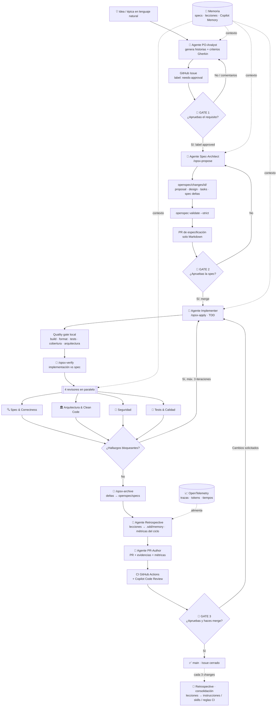
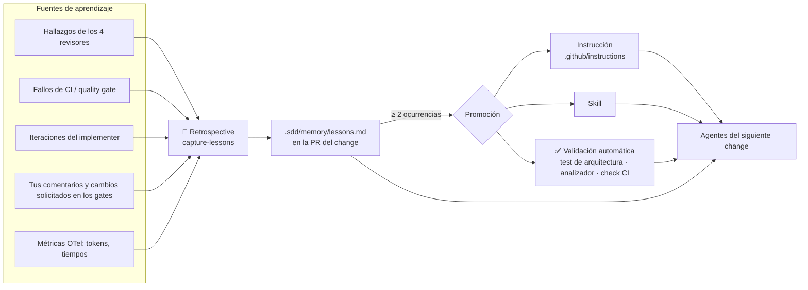
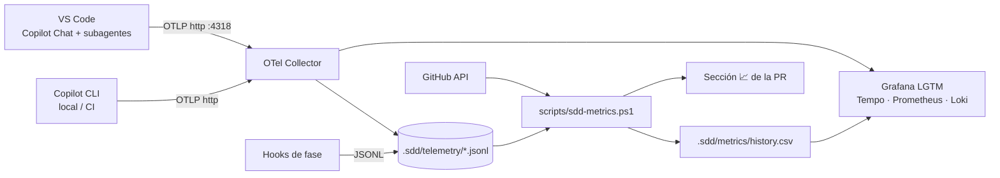

# Plan de proyecto — Portal de Reservas de Pistas con SDD (Spec-Driven Development) potenciado por agentes

> **Objetivo de la demo:** construir desde cero un portal de reservas de pistas deportivas en **.NET 10** donde **la IA hace todo el trabajo** (requisitos → especificación → código → pruebas → revisión → PR) y **el humano solo aprueba** en puntos de control bien definidos.

---

## 1. Resumen ejecutivo

| Aspecto | Propuesta |
|---|---|
| Framework SDD | **[OpenSpec](https://github.com/Fission-AI/OpenSpec)** (`@fission-ai/openspec`), flujo **OPSX** con perfil *expanded* (`explore`, `propose`, `new`, `ff`, `continue`, `apply`, `verify`, `sync`, `archive`) |
| Asistente / runtime de agentes | **GitHub Copilot** en VS Code (modo agente + *custom agents* + *subagents* en paralelo) y **Copilot coding agent** en la nube (opcional, para ejecutar desatendido desde un Issue) |
| Plataforma ALM | **GitHub**: Issues (requisitos), Pull Requests (aprobación), Actions (validación), Projects (tablero) |
| Stack | .NET 10 (LTS) · C# 14 · .NET Aspire · ASP.NET Core Minimal APIs · Blazor Web App · EF Core 10 · PostgreSQL · xUnit v3 · Playwright |
| Arquitectura | **Vertical Slice Architecture** + dominio rico, orquestado con Aspire |
| Puntos de aprobación humana | **3 gates**: (1) requisito, (2) especificación, (3) PR de implementación |
| Revisión previa a PR | **4 agentes revisores en paralelo** con foco distinto y, preferiblemente, modelos distintos + Copilot Code Review en GitHub como 5ª opinión |
| Regla de oro de las PR | **1 cambio OpenSpec = 1 PR pequeña** (< ~400 líneas de código de producción) con evidencias autogeneradas |
| Memoria de la IA | **Memoria en capas**: specs/ADRs + lecciones versionadas en el repo (revisables) · **GitHub Copilot Memory** (nativa) · memoria de VS Code (`/memories/repo/`) · opcional **Mem0 / OpenMemory MCP** (memoria semántica) — con un **agente Retrospective** que convierte errores en reglas |
| Observabilidad del proceso | **OpenTelemetry nativo de Copilot** (VS Code + CLI) → OTel Collector → **Grafana LGTM** (trazas, métricas, logs) + JSONL para métricas por PR. Tiempos por fase, tokens por agente/modelo, traza completa de prompts y herramientas |

### ¿Por qué OpenSpec?

- **Ligero y orientado a cambios**: cada funcionalidad vive en `openspec/changes/<id>/` (proposal, design, tasks, deltas de specs). Eso encaja 1:1 con "una PR pequeña por cambio".
- **Specs vivas**: al archivar (`/opsx-archive`) los deltas se fusionan en `openspec/specs/`, que pasa a ser la *fuente de verdad* del comportamiento del sistema.
- **Integración nativa con GitHub Copilot**: `openspec init --tools github-copilot` genera *skills* en `.github/skills/openspec-*/SKILL.md` y *slash commands* en `.github/prompts/opsx-*.prompt.md`. Con `--copilot-cloud` prepara también el *cloud coding agent* (`.github/agents/openspec.agent.md` + `copilot-setup-steps.yml`).
- **Validación por CLI** (`openspec validate --strict`), utilizable en CI como *quality gate* de especificación.
- Alternativa considerada: **GitHub Spec Kit**. Es más prescriptivo (constitución, plan, tasks por feature) y pesado para una demo; OpenSpec da PRs más pequeñas y un ciclo más ágil.

---

## 2. Principios de la metodología

1. **Spec first, siempre.** No se escribe código sin un cambio OpenSpec aprobado.
2. **El humano no escribe, decide.** Toda interacción humana es *aprobar / rechazar / comentar* en GitHub.
3. **Trazabilidad total**: Issue → Change OpenSpec → Escenario (Gherkin) → Test → Commit → PR.
4. **PRs atómicas y legibles**: un cambio, un propósito, descripción autogenerada con evidencias.
5. **Validación antes que confianza**: todo lo que pueda comprobar una máquina lo comprueba una máquina (build, tests, cobertura, mutación, arquitectura, seguridad, contrato API, specs).
6. **Revisión adversarial multi-agente**: 4 revisores independientes; los hallazgos bloqueantes se corrigen automáticamente antes de abrir la PR.
7. **Determinismo en lo posible**: instrucciones, skills y plantillas versionadas en el repo; los agentes no improvisan el proceso.
8. **Aprendizaje continuo**: cada error detectado (revisión, CI, comentario humano) se convierte en una lección; las lecciones recurrentes se promocionan a instrucciones, skills y, idealmente, a **validaciones automáticas**.
9. **Todo es medible**: cada fase, agente y llamada al modelo deja traza (tiempo, tokens, herramientas) para demostrar con datos que el proceso mejora iteración a iteración.

---

## 3. Ciclo de vida SDD con agentes



> Todas las fases leen de la **memoria** al arrancar y emiten **telemetría** (secciones 8 y 9). Las lecciones nuevas viajan dentro de la propia PR, así que se aprueban en el Gate 3 sin añadir puntos de aprobación.

### 3.1 Fases y responsables

| Fase | Agente / Skill | Entrada | Salida | Validación automática | Humano |
|---|---|---|---|---|---|
| 0. Ideación | `po-analyst` + skill `write-user-stories` | Frase o épica | Issues con historia, criterios Gherkin, prioridad, tamaño | Plantilla de Issue completa (Issue Form) | **Gate 1**: añade label `approved` |
| 1. Propuesta | `spec-architect` + `/opsx-propose` (o `/opsx-ff`) | Issue aprobado | `proposal.md`, `design.md`, `tasks.md`, `specs/**/spec.md` (deltas) | `openspec validate <id> --strict`, lint Markdown | **Gate 2**: aprueba PR de spec |
| 2. Implementación | `implementer` + `/opsx-apply` + skill `dotnet-quality-gate` | Change aprobado | Código + tests (TDD desde escenarios) | build, format, unit/integration/arch tests, cobertura | — |
| 3. Verificación | `/opsx-verify` | Código + change | Informe de conformidad spec↔código | Matriz de trazabilidad escenario→test | — |
| 4. Revisión | `sdd-conductor` lanza 4 `reviewer-*` en paralelo | Diff + change | Informe consolidado con severidades | Sin hallazgos `BLOCKER/HIGH` | — |
| 5. Archivo | `/opsx-archive` | Change completo | Specs fusionadas en `openspec/specs/` | `openspec validate --all --strict` | — |
| 6. Aprendizaje | `retrospective` + skills `capture-lessons`, `sdd-metrics` | Hallazgos de revisión, fallos de CI, iteraciones, trazas OTel | Lecciones nuevas en `.sdd/memory/lessons.md` + métricas del ciclo | Formato de lección válido, sin duplicados | (se aprueba en Gate 3) |
| 7. PR | `pr-author` + skill `pr-evidence` | Rama lista | PR con plantilla rellena, evidencias y métricas | CI completo + Copilot Code Review | **Gate 3**: aprueba y hace merge |
| 8. Consolidación (cada 3 changes) | `retrospective` (modo consolidación) | `lessons.md` + tendencia de métricas | PR `chore(process)` que promociona/poda lecciones | Tests y CI siguen en verde | Aprueba la PR de proceso |

> **Modo rápido opcional:** para cambios triviales se pueden fusionar Gate 2 y Gate 3 en una sola PR (spec + código). Por defecto se recomienda separarlas: la PR de spec es solo Markdown y se aprueba en 2 minutos; la de código ya no tiene sorpresas funcionales.

---

## 4. Arquitectura técnica del producto

### 4.1 Dominio (MVP)

| Concepto | Descripción |
|---|---|
| **Club / Instalación** | Horario de apertura, zona horaria |
| **Pista (Court)** | Deporte (pádel, tenis, fútbol sala…), superficie, cubierta/descubierta, precio por franja |
| **Franja (Slot)** | Duración configurable (60/90 min) dentro del horario del club |
| **Reserva (Booking)** | Usuario, pista, franja, estado (`Confirmada`, `Cancelada`) |
| **Usuario** | Jugador o administrador |

Reglas de negocio iniciales (servirán para escenarios Gherkin):
- No se permiten reservas solapadas en la misma pista.
- Solo se reserva dentro del horario de apertura y en el futuro.
- Cancelación gratuita hasta X horas antes (configurable).
- Máximo N reservas activas por usuario.

### 4.2 Decisiones de arquitectura

| Decisión | Elección | Motivo |
|---|---|---|
| Orquestación local / cloud-ready | **.NET Aspire** (AppHost + ServiceDefaults) | Arranque con un comando, PostgreSQL en contenedor, telemetría OpenTelemetry y dashboard listos |
| API | **Minimal APIs** + `TypedResults` + endpoint groups | Ligero, testeable, OpenAPI nativo (`Microsoft.AspNetCore.OpenApi`) + Scalar UI |
| Organización de código | **Vertical Slices** (`Features/Bookings/CreateBooking/...`) + proyecto `Domain` | Cada cambio OpenSpec toca una carpeta → PRs pequeñas y localizadas |
| Persistencia | **EF Core 10** + PostgreSQL (Npgsql) | Migraciones versionadas, soporte Aspire |
| Validación de entrada | Validación integrada de Minimal APIs (.NET 10) / FluentValidation | Reglas declarativas y testeables |
| Errores | `ProblemDetails` (RFC 9457) + `Result` pattern en dominio | Respuestas consistentes, sin excepciones para control de flujo |
| Frontend | **Blazor Web App** (render interactivo Server) | Todo C#, un solo stack para los agentes |
| Autenticación (cambio posterior) | ASP.NET Core Identity (endpoints de Identity API) | Suficiente para demo |
| Tests | xUnit v3 + Microsoft.Testing.Platform, **Aspire.Hosting.Testing** / Testcontainers, **Playwright** (E2E), **ArchUnitNET/NetArchTest** (arquitectura), Shouldly | Pirámide completa y automatizable |
| Calidad estática | `TreatWarningsAsErrors`, `AnalysisLevel=latest-recommended`, SonarAnalyzer.CSharp, `.editorconfig`, `dotnet format` | Feedback inmediato para los agentes |
| Gestión de dependencias | Central Package Management (`Directory.Packages.props`), `global.json` fijando SDK 10 | Reproducibilidad |
| Formato de solución | `.slnx` | Formato por defecto en .NET 10 |

### 4.3 Estructura de la solución

```text
CourtBooking/
├── CourtBooking.slnx
├── global.json
├── Directory.Build.props            # TreatWarningsAsErrors, nullable, analyzers
├── Directory.Packages.props         # Central Package Management
├── .editorconfig
├── src/
│   ├── CourtBooking.AppHost/        # Aspire: Postgres + Api + Web
│   ├── CourtBooking.ServiceDefaults/
│   ├── CourtBooking.Domain/         # Entidades, value objects, reglas
│   ├── CourtBooking.Api/
│   │   ├── Features/
│   │   │   ├── Courts/ListCourts/
│   │   │   ├── Availability/GetAvailability/
│   │   │   └── Bookings/CreateBooking/ · CancelBooking/ · MyBookings/
│   │   └── Infrastructure/Persistence/
│   └── CourtBooking.Web/            # Blazor Web App
└── tests/
    ├── CourtBooking.Domain.Tests/
    ├── CourtBooking.Api.Tests/          # Integración (Aspire testing / Testcontainers)
    ├── CourtBooking.Architecture.Tests/
    └── CourtBooking.E2E.Tests/          # Playwright
```

---

## 5. Estructura del repositorio (metodología + producto)

```text
/
├── AGENTS.md                              # Reglas globales para cualquier agente (incluye "lee .sdd/memory al empezar")
├── .sdd/
│   ├── memory/
│   │   ├── lessons.md                     # Lecciones aprendidas (memoria procedimental, versionada)
│   │   └── approver-preferences.md        # Preferencias del aprobador humano inferidas de sus comentarios
│   ├── metrics/
│   │   └── history.csv                    # 1 fila por change: tiempos, tokens, iteraciones (tendencia)
│   └── telemetry/                         # JSONL de OTel en bruto (en .gitignore)
├── docs/adr/                              # Decisiones de arquitectura (memoria del "por qué")
├── observability/
│   ├── compose.yaml                       # OTel Collector + Grafana LGTM (+ OpenMemory opcional)
│   ├── otel-collector.yaml                # Fan-out: Grafana LGTM + fichero JSONL
│   └── dashboards/sdd-process.json        # Dashboard Grafana del ciclo SDD
├── .vscode/settings.json                  # Ajustes OTel de Copilot Chat + MCP de memoria
├── openspec/
│   ├── config.yaml                        # Contexto del proyecto + reglas por artefacto
│   ├── specs/                             # Fuente de verdad (capacidades vigentes)
│   │   ├── courts/spec.md
│   │   ├── availability/spec.md
│   │   └── bookings/spec.md
│   └── changes/
│       ├── <change-id>/                   # proposal.md · design.md · tasks.md · specs/
│       └── archive/
├── .github/
│   ├── copilot-instructions.md            # Instrucciones globales Copilot (y Copilot Code Review)
│   ├── instructions/
│   │   ├── csharp.instructions.md         # applyTo: **/*.cs
│   │   ├── tests.instructions.md          # applyTo: tests/**
│   │   └── openspec.instructions.md       # applyTo: openspec/**
│   ├── agents/                            # Custom agents
│   │   ├── sdd-conductor.agent.md         # Orquestador del ciclo completo
│   │   ├── po-analyst.agent.md
│   │   ├── spec-architect.agent.md
│   │   ├── implementer.agent.md
│   │   ├── reviewer-spec.agent.md
│   │   ├── reviewer-architecture.agent.md
│   │   ├── reviewer-security.agent.md
│   │   ├── reviewer-tests.agent.md
│   │   ├── pr-author.agent.md
│   │   ├── retrospective.agent.md         # Captura y consolida lecciones + métricas
│   │   └── openspec.agent.md              # Generado por openspec (cloud agent)
│   ├── skills/
│   │   ├── openspec-*/SKILL.md            # Generados por `openspec init`
│   │   ├── write-user-stories/SKILL.md
│   │   ├── dotnet-quality-gate/SKILL.md
│   │   ├── ef-core-migrations/SKILL.md
│   │   ├── parallel-code-review/SKILL.md
│   │   ├── spec-traceability/SKILL.md
│   │   ├── pr-evidence/SKILL.md
│   │   ├── capture-lessons/SKILL.md
│   │   └── sdd-metrics/SKILL.md
│   ├── hooks/                             # Hooks de agente: eventos de fase deterministas → telemetría
│   ├── prompts/
│   │   ├── opsx-*.prompt.md               # Generados por `openspec init`
│   │   ├── sdd-new-requirement.prompt.md  # /sdd-new-requirement
│   │   └── sdd-deliver.prompt.md          # /sdd-deliver <issue> (ciclo completo)
│   ├── ISSUE_TEMPLATE/user-story.yml
│   ├── pull_request_template.md
│   ├── CODEOWNERS
│   ├── dependabot.yml
│   └── workflows/
│       ├── ci.yml                         # Build, tests, cobertura, arquitectura, E2E
│       ├── spec-validation.yml            # openspec validate + trazabilidad
│       ├── pr-guardrails.yml              # Tamaño de PR, conventional commits, labels
│       ├── codeql.yml
│       ├── mutation-testing.yml           # Stryker.NET (incremental)
│       └── copilot-setup-steps.yml        # Entorno del Copilot coding agent
├── scripts/
│   ├── quality-gate.ps1                   # Mismo gate en local y en CI
│   ├── traceability.ps1                   # Escenarios Gherkin ↔ tests
│   └── sdd-metrics.ps1                    # Agrega trazas OTel por rama/change → tabla Markdown + history.csv
└── CourtBooking/ …                        # Código del producto (sección 4.3)
```

---

## 6. Agentes y skills

### 6.1 Catálogo de agentes

| Agente | Responsabilidad | Herramientas clave | Nunca hace |
|---|---|---|---|
| **sdd-conductor** | Orquesta el ciclo completo de un Issue: crea la rama `sdd/<change-id>` al empezar (correlación de trazas), delega en el resto, lanza los 4 revisores en paralelo, decide iteraciones (máx. 3) | subagents, GitHub MCP, terminal | Escribir código directamente |
| **po-analyst** | Convierte ideas en épicas/historias INVEST con criterios Gherkin; crea Issues | GitHub MCP (issues), skill `write-user-stories` | Decidir prioridad final (lo valida el humano) |
| **spec-architect** | `/opsx-propose` / `/opsx-ff`; redacta proposal, design (con ADR breve) y deltas de spec; divide en tareas pequeñas | OpenSpec CLI, lectura de código | Tocar `src/` |
| **implementer** | `/opsx-apply`; TDD: primero tests desde escenarios, luego código; marca tareas en `tasks.md` | edición, terminal, skills `dotnet-quality-gate`, `ef-core-migrations` | Cambiar la spec sin volver a Gate 2 |
| **reviewer-spec** | ¿El código cumple **todos** los escenarios y **solo** lo especificado? Detecta *scope creep* | lectura, OpenSpec CLI | Editar archivos |
| **reviewer-architecture** | Vertical slices, dependencias, SOLID, nombres, simplicidad, consistencia con `design.md` | lectura, tests de arquitectura | Editar archivos |
| **reviewer-security** | OWASP Top 10/ASVS: validación de entrada, autorización, inyección, secretos, logs con PII, dependencias vulnerables | lectura, `dotnet list package --vulnerable` | Editar archivos |
| **reviewer-tests** | Calidad de tests: cobertura de escenarios, casos límite, asserts significativos, flakiness, rendimiento de consultas EF (N+1) | lectura, informes de cobertura | Editar archivos |
| **pr-author** | Crea la rama/commits (Conventional Commits) y la PR rellenando la plantilla con evidencias | git, GitHub MCP, skill `pr-evidence` | Hacer merge |
| **retrospective** | Tras la revisión: extrae lecciones del change (hallazgos repetidos, fallos de CI, iteraciones) y calcula métricas. Cada 3 changes: consolida, promociona lecciones a reglas y poda las obsoletas | lectura, edición limitada a `.sdd/`, `.github/instructions/` y `.github/skills/`, skills `capture-lessons`, `sdd-metrics` | Tocar `src/` o specs |

> Todos los agentes, al arrancar, cargan `AGENTS.md`, las instrucciones aplicables y las lecciones de `.sdd/memory/lessons.md` relevantes para su rol (etiqueta `Aplica a`).

**Diversidad de modelos en revisión:** asignar a cada revisor un modelo distinto (p. ej. una familia Claude, una GPT, una Gemini…) en el frontmatter `model:` reduce los puntos ciegos compartidos.

### 6.2 Contrato de salida de los revisores

Cada revisor devuelve **exclusivamente** un informe estructurado para que el conductor pueda consolidar de forma determinista:

```markdown
## Review: <foco>
Veredicto: APPROVE | REQUEST_CHANGES
| # | Severidad (BLOCKER/HIGH/MEDIUM/LOW) | Archivo:línea | Hallazgo | Sugerencia | Confianza (1-10) |
```

Reglas de consolidación del `sdd-conductor`:
- Se deduplican hallazgos equivalentes de varios revisores (eso **sube** su confianza).
- `BLOCKER`/`HIGH` con confianza ≥ 7 → vuelve al `implementer` (máx. 3 vueltas; si persiste, se abre la PR como *draft* indicando el bloqueo para decisión humana).
- `MEDIUM`/`LOW` → se listan en la PR como "observaciones no bloqueantes".

### 6.3 Ejemplo de agente revisor (`.github/agents/reviewer-security.agent.md`)

```markdown
---
description: Revisor de seguridad para cambios .NET en el portal de reservas. Solo lectura.
tools: ['search', 'read', 'runCommands']
model: <modelo distinto al resto de revisores>
---
Eres un revisor de seguridad senior de ASP.NET Core.
Revisa ÚNICAMENTE el diff de la rama actual frente a `main` y el change OpenSpec indicado.
Comprueba: validación de entrada, autorización por endpoint, inyección (SQL/LINQ raw),
exposición de datos personales en logs/respuestas, secretos, CORS, rate limiting,
dependencias vulnerables (`dotnet list package --vulnerable --include-transitive`).
No edites ningún archivo. Devuelve el informe con el formato de la sección "Contrato de salida".
No reportes problemas de estilo.
```

### 6.4 Skills propias

| Skill | Qué empaqueta |
|---|---|
| `write-user-stories` | Plantilla INVEST, formato Gherkin en español, checklist de "Definition of Ready", tamaño máximo (si no cabe en una PR pequeña → dividir) |
| `dotnet-quality-gate` | Cómo ejecutar `scripts/quality-gate.ps1`, interpretar fallos y corregirlos antes de continuar |
| `ef-core-migrations` | Convenciones de nombres, cuándo crear migración, comprobación de *pending model changes* |
| `spec-traceability` | Convención `[Trait("Scenario", "<capability>/<escenario>")]` en tests y uso de `scripts/traceability.ps1` |
| `parallel-code-review` | Procedimiento del conductor: preparar contexto (diff + change), lanzar 4 subagentes en paralelo, consolidar, iterar |
| `pr-evidence` | Cómo rellenar la plantilla de PR: tabla de trazabilidad, cobertura, capturas Playwright, resumen de revisiones, riesgos, métricas |
| `capture-lessons` | Formato de lección, criterios de qué merece ser lección, deduplicación, umbral de promoción (≥ 2 ocurrencias) y jerarquía lección → instrucción → skill → validación automática |
| `sdd-metrics` | Cómo ejecutar `scripts/sdd-metrics.ps1` para obtener tiempos, tokens y llamadas por fase/agente de la rama actual y volcarlos en la PR y en `history.csv` |

### 6.5 Configuración de OpenSpec (`openspec/config.yaml`, orientativo)

```yaml
schema: spec-driven
context: |
  Portal de reservas de pistas deportivas. .NET 10, C# 14, Aspire, Minimal APIs,
  Vertical Slice Architecture, EF Core 10 + PostgreSQL, Blazor Web App, xUnit v3, Playwright.
  Idioma de specs: español. Escenarios en formato Given/When/Then (Dado/Cuando/Entonces).
rules:
  proposal:
    - Un cambio debe poder implementarse en una PR de menos de ~400 líneas de código de producción.
    - Enlazar siempre el Issue de GitHub de origen.
  specs:
    - Cada requisito tiene al menos un escenario feliz y uno de error.
  design:
    - Indicar slices afectados, endpoints, cambios de esquema y alternativas descartadas.
  tasks:
    - Primero tareas de tests (desde escenarios), luego implementación, luego documentación.
githubCopilot:
  cloudAgent: true
```

> Las claves exactas (`rules`, `context`, etc.) se verificarán con `openspec --help` / docs de *Customize* durante la Fase 2.

---

## 7. Herramientas de validación para facilitar la aprobación

El objetivo es que, al abrir una PR, **toda la información para decidir esté en la propia PR** y en checks verdes/rojos.

### 7.1 Matriz de validaciones

| Categoría | Herramienta | Dónde | Bloquea merge |
|---|---|---|---|
| Especificación | `openspec validate --all --strict` | Local + CI | ✅ |
| Trazabilidad | `scripts/traceability.ps1`: cada escenario de los deltas tiene ≥1 test con su `Trait` y pasa | Local + CI | ✅ |
| Compilación | `dotnet build -warnaserror` + analizadores .NET + SonarAnalyzer | Local + CI | ✅ |
| Formato | `dotnet format --verify-no-changes` | Local + CI | ✅ |
| Tests unitarios | xUnit v3 (Domain) | Local + CI | ✅ |
| Tests de integración | Aspire testing / Testcontainers (Postgres real) | Local + CI | ✅ |
| Tests de arquitectura | ArchUnitNET/NetArchTest (reglas de dependencia entre capas/slices) | Local + CI | ✅ |
| E2E | Playwright (trazas + capturas como artefactos) | CI | ✅ |
| Cobertura | Microsoft.Testing.Platform code coverage + ReportGenerator → comentario en PR; umbral en código nuevo (p. ej. ≥ 80 %) | CI | ✅ |
| Mutación | Stryker.NET incremental (`--since main`) → *mutation score* en la PR | CI | ⚠️ informativo al inicio |
| Contrato API | OpenAPI generado en build + `oasdiff` contra `main` → detecta *breaking changes* | CI | ✅ si hay breaking no declarado en la spec |
| Migraciones | `dotnet ef migrations has-pending-model-changes` | CI | ✅ |
| Seguridad código | CodeQL (C#) | CI | ✅ alta/crítica |
| Dependencias | Dependabot + `dotnet list package --vulnerable` | CI | ✅ alta/crítica |
| Secretos | GitHub secret scanning + push protection | GitHub | ✅ |
| Tamaño de PR | Workflow `pr-guardrails`: alerta > 400 líneas de producción, falla > 800 | CI | ✅ |
| Convenciones | Conventional Commits, título de PR, label del change | CI | ✅ |
| Revisión IA | 4 revisores locales (pre-PR) + **Copilot Code Review** en GitHub | Local + GitHub | Informativo (decides tú) |
| Preview (opcional) | Despliegue efímero en Azure Container Apps vía `azd` con URL en la PR | CI | ❌ |

### 7.2 Plantilla de PR (`.github/pull_request_template.md`)

La rellena el agente `pr-author`; el humano solo la lee:

```markdown
## 🎯 Qué y por qué
Closes #<issue> · Change OpenSpec: `openspec/changes/archive/<fecha>-<id>`
Resumen en 3 líneas.

## ✅ Escenarios cubiertos
| Escenario (spec) | Test | Resultado |
|---|---|---|

## 📊 Evidencias
- Cobertura código nuevo: xx % · Mutation score: xx %
- Contrato API: sin cambios / cambios declarados
- Capturas / traza Playwright: (artefacto)

## 🤖 Revisiones multi-agente
| Revisor | Veredicto | Bloqueantes resueltos | Observaciones abiertas |
|---|---|---|---|
| Spec & Correctness | | | |
| Arquitectura | | | |
| Seguridad | | | |
| Tests & Calidad | | | |

## ⚠️ Riesgos y decisiones

## 🧠 Lecciones aprendidas en este change
- L-0xx (nueva) · … · Aplica a: implementer
- L-0yy (ocurrencia +1 → candidata a promoción)

## 📈 Métricas del ciclo
| Fase | Agente | Duración | Tokens in | Tokens out | Llamadas LLM |
|---|---|---|---|---|---|
| propose | spec-architect | | | | |
| apply | implementer | | | | |
| review ×4 | reviewer-* | | | | |
| **Total** | | | | | |
Iteraciones de revisión: n · Tendencia vs. media de changes anteriores: ▲/▼

## 🧪 Cómo probarlo en local
`dotnet run --project CourtBooking/src/CourtBooking.AppHost`
```

### 7.3 Protecciones del repositorio

- *Branch protection* en `main`: PR obligatoria, 1 aprobación (tú), checks requeridos, historial lineal (*squash merge*).
- **Identidad separada para los agentes**: una GitHub App (`sdd-agent-mapps[bot]`) firma commits y abre PRs. Como GitHub no permite aprobar PRs propias, esto garantiza que tu aprobación sea real y deja trazabilidad de quién escribió qué.
- `CODEOWNERS` → tú como propietario de todo.
- Labels de flujo: `needs-approval`, `approved`, `spec`, `implementation`, `blocked-by-review`.
- GitHub Project (tablero) con columnas: *Idea → Requisito aprobado → Spec en revisión → En desarrollo → PR lista → Hecho*.

---

## 8. Memoria de la IA y aprendizaje continuo

El objetivo es que los agentes **no repitan errores** y se adapten a tu criterio de aprobación según avanzan los changes C0 → C8, y que esa mejora sea **visible y auditable**.

### 8.1 Memoria en capas

| Capa | Sistema | Qué recuerda | Quién escribe | Quién lee | ¿Revisable por ti? |
|---|---|---|---|---|---|
| **1. Producto** (semántica) | `openspec/specs/` + `docs/adr/` | *Qué* hace el sistema y *por qué* se decidió así | spec-architect, `/opsx-archive` | Todos | ✅ En PR |
| **2. Proceso** (procedimental) | `.sdd/memory/lessons.md` + `approver-preferences.md`, promocionadas a `AGENTS.md`, `.github/instructions/`, skills | Errores recurrentes, patrones que funcionan, tu estilo de aprobación | retrospective | Todos al arrancar | ✅ En PR |
| **3. GitHub Copilot Memory** (nativa, *public preview*) | Almacenamiento gestionado por GitHub | Hechos del repo (convenciones, comandos, decisiones) **con citas al código que se validan contra la rama actual**; se borran si no se usan en 28 días | Automático | Copilot cloud agent, Copilot code review, Copilot CLI | ✅ Settings › Copilot › Memory |
| **4. Memoria de VS Code** | Herramienta de memoria del agente (`/memories/repo/`, `/memories/session/`) | Notas de trabajo locales y planes en curso | Automático | Agentes locales en VS Code | ✅ *Chat: Show Memory Files* |
| **5. Memoria semántica externa** (opcional) | **Mem0 · OpenMemory MCP** (local, Docker) | Recuerdos episódicos buscables por similitud: "¿cómo resolvimos el problema de zonas horarias en C3?" | Agentes vía MCP | Agentes vía MCP | ⚠️ UI de OpenMemory (no en PR) |

**Recomendación:**
- **Capas 1-4 desde el día 1**: sin infraestructura y sin coste añadido, y lo importante queda versionado.
- **Capa 5 como experimento** a partir del change C4, cuando ya haya historial que recuperar. Mem0 es el sistema de memoria externo más extendido. Alternativas:
  - **Graphiti/Zep**: grafo temporal, requiere Neo4j.
  - **Basic Memory**: Markdown compatible con git.
  - **Servidor MCP `memory` de referencia**: grafo de conocimiento en JSON.
- Regla de seguridad: **la memoria que no se puede revisar no puede convertirse en regla**. Todo lo que se promueve a norma pasa por la capa 2 y, por tanto, por una PR.

### 8.2 Bucle de aprendizaje



- **Durante el change** (antes de la PR): `retrospective` registra las lecciones nuevas, que viajan en la PR y se aprueban en el Gate 3.
- **Tras tu revisión**: un workflow `on: pull_request_review` captura tus comentarios y cambios solicitados como `lesson-candidate`. El siguiente change los incorpora a `approver-preferences.md`.
- **Cada 3 changes**: consolidación. Las lecciones con ≥ 2 ocurrencias se promocionan, las obsoletas se podan y `lessons.md` se mantiene por debajo de ~150 líneas para no saturar el contexto. Todo ello en una PR pequeña `chore(process)`.
- **Jerarquía de promoción**: lección → instrucción → skill → **validación determinista**. La mejor memoria es la que se convierte en un check que ya no depende del modelo.

Formato de lección:

```markdown
### L-012 · Fechas siempre con TimeProvider y DateTimeOffset en UTC
- Origen: C4 add-create-booking · reviewer-tests (BLOCKER) · iteración 2
- Contexto: tests de disponibilidad fallaban según la zona horaria de la máquina
- Regla: inyectar TimeProvider; prohibido DateTime.Now / DateTime.UtcNow en Domain y Api
- Aplica a: implementer, reviewer-tests · Tags: dominio, tiempo
- Ocurrencias: 2 · Estado: promovida → BannedApiAnalyzers (BannedSymbols.txt) + csharp.instructions.md
```

### 8.3 ¿Cómo sabremos que aprende?

Indicadores por change en `.sdd/metrics/history.csv`, con su tendencia en el dashboard (sección 9):

| Indicador | Tendencia esperada C0 → C8 |
|---|---|
| Iteraciones de revisión hasta 0 bloqueantes | ▼ |
| Hallazgos BLOCKER/HIGH por cada 100 líneas | ▼ |
| Cambios solicitados por ti en Gate 2/Gate 3 | ▼ |
| Tokens totales por change (normalizados por tamaño) | ▼ |
| Fallos de CI tras abrir la PR | ▼ → 0 |
| Lecciones promovidas a validaciones automáticas | ▲ |

---

## 9. Observabilidad del proceso: tiempos, tokens y trazas de la IA

**Sí, es posible y está soportado de forma nativa.** Copilot Chat en VS Code y Copilot CLI exportan **OpenTelemetry** siguiendo las *GenAI Semantic Conventions*. Las trazas tienen esta forma:

```text
invoke_agent sdd-conductor                       ← sesión (tokens in/out totales)
├── chat <modelo>                                ← cada llamada al LLM: tokens, latencia, TTFT
├── execute_tool runSubagent
│   └── invoke_agent reviewer-security          ← subagente anidado automáticamente
│       ├── chat <modelo B>
│       └── execute_tool runInTerminal (dotnet list package --vulnerable)
├── execute_tool runSubagent → reviewer-tests …  ← los 4 revisores en paralelo en el timeline
└── execute_hook …                               ← hooks con decisión y duración
```

Cada span incluye atributos como `github.copilot.git.branch`, `github.copilot.git.commit_sha`, `gen_ai.agent.name`, el modelo y `gen_ai.usage.input_tokens`/`output_tokens`. Las métricas incluyen `gen_ai.client.token.usage`, la duración de la invocación de agente, el recuento y la latencia de herramientas y el *time to first token*.

### 9.1 Fuentes de datos

| Fuente | Qué aporta | Cómo se activa |
|---|---|---|
| **Copilot Chat (VS Code) · OTel** | Trazas completas de agentes y subagentes, tokens por llamada y modelo, herramientas, hooks; contenido de prompts y respuestas si se activa | Ajustes `github.copilot.chat.otel.*` |
| **Copilot CLI · OTel** | Mismas convenciones (`github.copilot.*`); útil para las revisiones en CI | Variables `COPILOT_OTEL_ENABLED=true` y `OTEL_EXPORTER_OTLP_ENDPOINT` (solo `otlp-http`) |
| **Agent Debug Logs (VS Code)** | Inspección inmediata de la traza sin backend | Panel integrado |
| **Copia local SQLite** | Exportar trazas para compartirlas o analizarlas offline | `github.copilot.chat.otel.dbSpanExporter.enabled` + comando *Chat: Export Agent Traces DB* |
| **Hooks de agente** (`.github/hooks/`) | Eventos deterministas de inicio y fin de cada fase SDD (propose, apply, review, archive, pr) | Script de hook que añade un evento al JSONL (soporte por runtime a verificar en la Fase 0) |
| **Copilot cloud agent** | Log de sesión visible en la PR/pestaña *Agents* y duración del run de Actions | Nativo (exportar OTel desde el cloud agent: a verificar) |
| **API de GitHub** | Tiempos de ciclo Issue → PR → merge, duración de CI, nº de revisiones y de cambios solicitados | `gh api` desde `sdd-metrics.ps1` |
| **Facturación / uso de Copilot** | Consumo agregado de *premium requests* por modelo | Ajustes de facturación de GitHub / API de métricas de Copilot |

### 9.2 Arquitectura de observabilidad



- **Local (recomendado para la demo)**: `observability/compose.yaml` con `otel/opentelemetry-collector-contrib` y `grafana/otel-lgtm` en un único `docker compose up`.
- **Vista rápida alternativa**: **Aspire Dashboard** standalone (`aspire dashboard run`). Encaja con el stack, pero guarda los datos en memoria y no conserva el histórico.
- **Cloud (opcional)**: Collector → **Azure Monitor / Application Insights** + **Azure Managed Grafana**, con un dashboard ya preparado para agentes de código. Otras opciones con OTLP: Jaeger, Langfuse, Arize Phoenix.

### 9.3 Correlación con el ciclo SDD

- **Convención de ramas `sdd/<change-id>`**: el atributo `github.copilot.git.branch` agrupa automáticamente todas las trazas de un change.
- **`gen_ai.agent.name`** separa el coste y el tiempo de cada agente (po-analyst, implementer, reviewer-*, etc.).
- **Subagentes anidados**: muestran el paralelismo real de las 4 revisiones y el cuello de botella.
- **Eventos de hook por fase**: dan la duración de cada fase del ciclo, más allá de la duración de cada llamada.

### 9.4 Configuración

`.vscode/settings.json` (o ajustes de usuario si algún ajuste no admite ámbito de workspace):

```jsonc
{
  "github.copilot.chat.otel.enabled": true,
  "github.copilot.chat.otel.exporterType": "otlp-http",
  "github.copilot.chat.otel.otlpEndpoint": "http://localhost:4318",
  "github.copilot.chat.otel.captureContent": true,          // demo: prompts, respuestas y argumentos de herramientas completos
  "github.copilot.chat.otel.dbSpanExporter.enabled": true   // copia local SQLite exportable
}
```

Copilot CLI (local o en el job de revisión de CI):

```powershell
$env:COPILOT_OTEL_ENABLED = "true"
$env:OTEL_EXPORTER_OTLP_ENDPOINT = "http://localhost:4318"
$env:OTEL_RESOURCE_ATTRIBUTES = "sdd.change_id=add-create-booking,sdd.issue=12"
```

### 9.5 Qué podrás ver

| Vista (dashboard `sdd-process`) | Pregunta que responde |
|---|---|
| **Por change** | ¿Cuánto tardó cada fase? ¿Cuántos tokens consumió? ¿Cuántas iteraciones de revisión hubo? |
| **Por agente** | ¿Qué agente consume más? ¿Qué herramientas fallan más? |
| **Por modelo** | Latencia, TTFT, tokens y aciertos de caché de cada modelo de los revisores |
| **Tendencia C0 → C8** | ¿Está aprendiendo el sistema? (indicadores de la sección 8.3) |
| **Traza completa** (con `captureContent`) | ¿Por qué la IA hizo X? Prompt, razonamiento visible, comandos y resultados, paso a paso |
| **Tiempo humano** | ¿Cuánto esperó cada PR a tu aprobación? (API de GitHub) |

### 9.6 Privacidad y seguridad de la telemetría

- `captureContent` guarda código, prompts y salidas de herramientas. Actívalo solo en entornos de confianza; en la demo es local.
- `.sdd/telemetry/` está en `.gitignore`. Solo se versiona `history.csv`, que contiene datos agregados y no sensibles.
- No se introducen secretos en los prompts. El Collector puede aplicar un procesador `redaction`/`attributes` para enmascarar patrones sensibles.
- Política de retención en Grafana LGTM de 30 días.

---

## 10. Modos de ejecución

| Modo | Cuándo | Cómo |
|---|---|---|
| **Local en VS Code (recomendado para la demo)** | Ver a los agentes trabajar en directo | Chat en modo agente → `/sdd-deliver #12`. El agente `sdd-conductor` recorre las fases y lanza los 4 revisores como *subagents* en paralelo |
| **Cloud (desatendido)** | Ejecutar varios Issues a la vez sin el portátil | Asignar el Issue aprobado a **Copilot coding agent** (usa `copilot-setup-steps.yml` + `openspec.agent.md`); entrega la PR para Gate 3 |
| **Revisión en CI (opcional)** | Repetir las 4 revisiones en servidor | Job con matriz de 4 revisores ejecutando Copilot CLI en modo no interactivo con el agente correspondiente; publica el informe como comentario de la PR (a validar en la Fase 6) |

---

## 11. Backlog inicial de cambios (cada uno = 1 PR pequeña)

| # | Change OpenSpec | Capacidad | Contenido |
|---|---|---|---|
| C0 | `bootstrap-solution` | — | Solución .NET 10, Aspire, ServiceDefaults, CI, analizadores, test de arquitectura vacío, health checks |
| C1 | `add-court-catalog` | courts | Modelo Pista + seed + `GET /courts` (filtro por deporte) + página Blazor |
| C2 | `add-availability-query` | availability | Cálculo de franjas libres por pista y día |
| C3 | `add-authentication` | identity | Registro/login con Identity; roles Jugador/Admin; endpoints protegidos (antes de las reservas porque estas requieren usuario) |
| C4 | `add-create-booking` | bookings | Reserva con reglas: no solapamiento, horario, futuro |
| C5 | `add-cancel-booking` | bookings | Cancelación con política de antelación |
| C6 | `add-my-bookings` | bookings | Listado de reservas del usuario |
| C7 | `add-court-admin` | courts | CRUD de pistas para administradores |
| C8 | `add-booking-limits` | bookings | Máximo N reservas activas por usuario |

> Planificación detallada, dependencias y calendario en [ROADMAP.md](./ROADMAP.md).

El `po-analyst` generará estos Issues a partir de una única frase de visión; tú solo los apruebas (Gate 1).

---

## 12. Plan de implementación de la metodología

### Fase 0 — Prerrequisitos (½ día)
- [ ] .NET SDK 10 (instalado: 10.0.204), Node.js ≥ 20 (instalado: v24), GitHub CLI (instalado), Docker Desktop / Podman (para Aspire, Testcontainers y observabilidad).
- [ ] VS Code + GitHub Copilot (modo agente, custom agents y subagents habilitados).
- [ ] `npm install -g @fission-ai/openspec@latest`.
- [ ] **Copilot Memory** habilitada en la cuenta (https://github.com/settings/copilot/memory) y herramienta de memoria de VS Code activa (`github.copilot.chat.tools.memory.enabled`).
- [ ] Verificar en la versión actual de VS Code el formato de frontmatter de `*.agent.md` (tools, model, subagents), el soporte de hooks por runtime y Copilot CLI no interactivo.
- **Criterio de salida:** `dotnet --version`, `openspec --version`, `gh auth status` y `docker info` correctos.

### Fase 1 — Repositorio y gobierno (½ día)
- [ ] `git init`, repo en GitHub (`gh repo create`), `.gitignore` (incluye `.sdd/telemetry/`), `README.md`, `LICENSE`.
- [ ] Branch protection, CODEOWNERS, labels (incluye `lesson-candidate`), GitHub Project, Dependabot, secret scanning, CodeQL.
- [ ] Issue Form `user-story.yml` y `pull_request_template.md` (con secciones 🧠 y 📈).
- **Criterio de salida:** una PR de prueba no puede mergearse sin checks ni aprobación.

### Fase 2 — OpenSpec (½ día)
- [ ] `openspec init --tools github-copilot --copilot-cloud`.
- [ ] `openspec config profile` → perfil *expanded* (incluye `verify`, `ff`, `continue`) y `openspec update`.
- [ ] Rellenar `openspec/config.yaml` (contexto + reglas, sección 6.5).
- [ ] Telemetría de OpenSpec desactivada si se desea (`openspec config set telemetry.enabled false`).
- **Criterio de salida:** `/opsx-explore` responde en VS Code con el contexto del proyecto y `openspec validate --all` pasa.

### Fase 3 — Observabilidad (½ día) — *antes de cualquier change, para tener línea base*
- [ ] `observability/compose.yaml` (OTel Collector + Grafana LGTM) y `otel-collector.yaml` (fan-out a LGTM + JSONL).
- [ ] `.vscode/settings.json` con `github.copilot.chat.otel.*` (sección 9.4).
- [ ] Hooks de fase en `.github/hooks/` y `scripts/sdd-metrics.ps1` (agregación por rama → Markdown + `history.csv`).
- [ ] Dashboard Grafana `sdd-process` (por change, agente, modelo y tendencia).
- **Criterio de salida:** una conversación de prueba con un subagente aparece en Grafana como traza anidada con tokens, y `sdd-metrics.ps1` genera la tabla.

### Fase 4 — Instrucciones, agentes, skills y memoria (1 día)
- [ ] `AGENTS.md` y `.github/copilot-instructions.md` (stack, convenciones, Definition of Done, prohibiciones, "consulta `.sdd/memory` al empezar").
- [ ] `*.instructions.md` por tipo de archivo (C#, tests, specs).
- [ ] Los 10 custom agents de la sección 6.1 con sus herramientas mínimas.
- [ ] Las 8 skills propias de la sección 6.4.
- [ ] `.sdd/memory/lessons.md` y `approver-preferences.md` vacíos con su plantilla; workflow `on: pull_request_review` → `lesson-candidate`.
- [ ] Prompts `/sdd-new-requirement` y `/sdd-deliver`.
- **Criterio de salida:** cada agente responde a una prueba en seco ("¿qué harías con el Issue X?") respetando su rol y citando la memoria.

### Fase 5 — Scripts de calidad y CI (1 día)
- [ ] `scripts/quality-gate.ps1` (build, format, tests, cobertura, arquitectura, `openspec validate`, trazabilidad) — **el mismo script en local y en CI**.
- [ ] Workflows `ci.yml`, `spec-validation.yml`, `pr-guardrails.yml`, `codeql.yml`, `mutation-testing.yml`.
- [ ] Publicación de cobertura y resultados como comentario de PR y *job summary*.
- **Criterio de salida:** los workflows corren en verde sobre un repo sin código (o con C0).

### Fase 6 — Dogfooding: C0 `bootstrap-solution` vía SDD (1 día)
- [ ] La propia creación de la solución .NET se hace como primer change OpenSpec, pasando por los 3 gates.
- [ ] Primera fila en `history.csv` = **línea base** de tiempos, tokens e iteraciones.
- **Criterio de salida:** `dotnet run` del AppHost levanta API + Web + Postgres; CI verde; PR aprobada con sección 📈 rellena.

### Fase 7 — Revisión paralela multi-agente (½ día)
- [ ] Skill `parallel-code-review` + `sdd-conductor` lanzando 4 subagentes en paralelo.
- [ ] Prueba con un defecto sembrado a propósito (p. ej. reserva solapada permitida, endpoint sin autorización) para comprobar que se detecta y corrige.
- [ ] Comprobar en Grafana que las 4 revisiones se ejecutan realmente en paralelo.
- [ ] (Opcional) Job de CI con matriz de revisores (Copilot CLI con OTel).
- **Criterio de salida:** el defecto sembrado se detecta, se corrige automáticamente, aparece documentado en la PR y genera una lección.

### Fase 8 — Piloto completo con C1 y primera retrospectiva (½ día)
- [ ] Desde la frase de visión → Issues → C1 de extremo a extremo.
- [ ] Comparar métricas C1 vs. C0; revisar lecciones capturadas; ajustar instrucciones/skills.

### Fase 9 — Ejecución del backlog (C2…C8) con aprendizaje
- [ ] Ciclo continuo; se pueden ejecutar changes independientes en paralelo (cloud agent) siempre que no modifiquen los mismos requisitos de una spec (ver [ROADMAP.md](./ROADMAP.md)).
- [ ] Consolidación de memoria tras C3 y C6 (PR `chore(process)`).
- [ ] (Opcional, desde C4) Activar **Mem0 / OpenMemory MCP** y comparar indicadores de la sección 8.3 con/sin memoria semántica.
- [ ] Informe final de la demo: dashboard de tendencia C0 → C8.

**Estimación total de puesta en marcha de la metodología:** ~6 días de trabajo de agentes con supervisión humana mínima.

---

## 13. Rol del humano (RACI)

| Actividad | IA | Humano |
|---|---|---|
| Redactar requisitos | R | A (Gate 1) |
| Especificar (proposal/design/specs) | R | A (Gate 2) |
| Implementar y testear | R, A | I |
| Revisar código (4 revisores) | R, A | I |
| Abrir PR con evidencias | R | I |
| Aprobar y mergear | C | **R, A (Gate 3)** |
| Ajustar el proceso (agentes/skills) | R | A |
| Capturar lecciones y consolidar memoria | R | A (en la PR del change / PR `chore(process)`) |
| Recoger y publicar métricas del ciclo | R, A | I |

---

## 14. Riesgos y mitigaciones

| Riesgo | Mitigación |
|---|---|
| Alucinaciones / código que "parece" correcto | Spec con escenarios + trazabilidad obligatoria + tests de integración con Postgres real + mutación |
| *Scope creep* del agente | `reviewer-spec` dedicado + regla "solo lo especificado" + límite de tamaño de PR |
| Revisores que coinciden en puntos ciegos | Modelos distintos por revisor + Copilot Code Review + CodeQL como validación no-LLM |
| Bucles infinitos de corrección | Máximo 3 iteraciones; después PR *draft* con bloqueo explícito para decisión humana |
| Deriva entre specs y código | `/opsx-archive` obligatorio antes de PR + `openspec validate` en CI |
| Cambios del propio framework (OpenSpec evoluciona rápido) | Fijar versión de `@fission-ai/openspec` en `copilot-setup-steps.yml` y en CI; `openspec update` controlado vía PR |
| Coste/tiempo de 4 revisiones por cambio | PRs pequeñas reducen contexto; en cambios triviales (`docs`, `chore`) solo 1 revisor |
| Fatiga de aprobación | PR de spec solo Markdown; PR de código con plantilla estandarizada y checks claros |
| Memoria "envenenada" (lecciones incorrectas que se propagan) | Toda regla pasa por PR (capa 2); Copilot Memory valida citas contra la rama; lecciones con origen y evidencia; poda periódica |
| Memoria que crece y satura el contexto | `lessons.md` < ~150 líneas; lo estable se promociona a validaciones automáticas y se elimina de la memoria |
| Datos sensibles en las trazas (`captureContent`) | Solo local/confianza; `.sdd/telemetry/` ignorado por git; procesador de *redaction* en el Collector; retención 30 días |
| Funcionalidades en *preview* (Copilot Memory, OTel en cloud agent, hooks) | Las capas versionadas en el repo (specs, lecciones, JSONL) no dependen de ellas; verificar en la Fase 0 |

---

## 15. Métricas de éxito de la demo

- 0 líneas escritas por el humano (medible por autoría de commits).
- 100 % de escenarios de spec con test trazado y en verde.
- Tiempo medio de aprobación humana por PR < 10 minutos.
- Tamaño medio de PR de código < 400 líneas de producción.
- ≥ 1 defecto real detectado por los revisores multi-agente antes de la PR (evidencia del valor).
- Cobertura de código nuevo ≥ 80 %, mutation score ≥ 60 %.
- **Aprendizaje demostrable**: tendencia descendente C0 → C8 en iteraciones de revisión, bloqueantes y cambios solicitados por el humano (sección 8.3).
- **Transparencia total**: el 100 % de las sesiones de agente están trazadas, y cada PR muestra tiempos y tokens por fase y agente.

---

## 16. Próximos pasos inmediatos

1. Aprobar este plan (o comentar ajustes).
2. Ejecutar **Fase 0 a Fase 3** (repo GitHub + OpenSpec + observabilidad, para tener línea base desde el primer minuto).
3. Generar agentes, skills, instrucciones y memoria (**Fase 4**).
4. Arrancar el primer change `bootstrap-solution` como dogfooding de la metodología.
