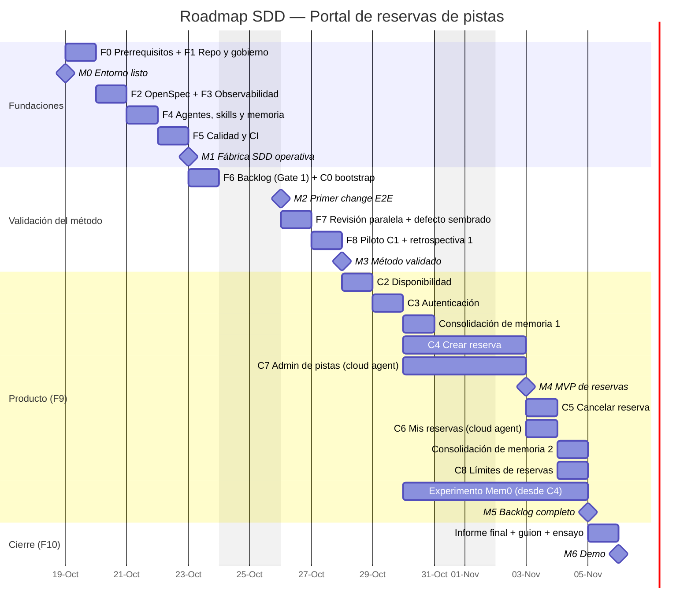
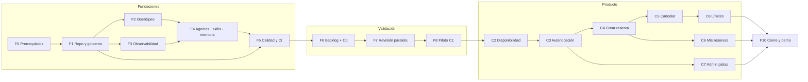

# Roadmap — Portal de Reservas de Pistas con SDD potenciado por agentes

> Documento complementario de [PLAN-PROYECTO-SDD.md](./PLAN-PROYECTO-SDD.md). Detalla **todo lo que hay que hacer**: hitos, calendario, dependencias, tareas, entregables, criterios de aceptación y la parte que te toca como aprobador.
>
> **Leyenda:** 🤖 lo hace un agente · 👤 lo haces tú (solo decidir/aprobar) · 🔀 se puede hacer en paralelo · ⛩️ gate de aprobación

---

## 1. Visión general

| Hito | Fecha objetivo | Qué significa | Evidencia |
|---|---|---|---|
| **M0 · Entorno listo** | lun 19-oct-2026 | Herramientas verificadas, repo GitHub protegido | PR de prueba bloqueada sin checks ni aprobación |
| **M1 · Fábrica SDD operativa** | jue 22-oct-2026 | OpenSpec, agentes, skills, memoria, observabilidad y CI funcionando | Traza de prueba en Grafana + CI verde + agentes respondiendo en seco |
| **M2 · Primer change de extremo a extremo** | vie 23-oct-2026 | C0 `bootstrap-solution` entregado por agentes pasando los 3 gates | PR C0 mergeada + línea base de métricas |
| **M3 · Método validado** | mar 27-oct-2026 | Revisión paralela probada con defecto sembrado + piloto C1 + primera retrospectiva | Defecto detectado y corregido; lección capturada |
| **M4 · MVP de reservas** | lun 02-nov-2026 | Se puede ver pistas, consultar disponibilidad, autenticarse y reservar | C1–C4 en `main`, E2E verde |
| **M5 · Backlog completo** | mié 04-nov-2026 | C0–C8 entregados; 2 consolidaciones de memoria | 9 PRs de producto + 2 PRs de proceso |
| **M6 · Demo** | vie 06-nov-2026 | Informe final y dashboard de tendencia (¿aprende la IA?) | Demo en vivo de un change + dashboard C0→C8 |

**Duración total:** 15 días laborables (~3 semanas) · **Esfuerzo humano estimado:** ~4–5 horas en total (sección 8).

---

## 2. Calendario (Gantt)

---

## 3. Dependencias

**Ruta crítica:** F0 → F1 → F2/F3 → F4 → F5 → F6 → F7 → F8 → C2 → C3 → C4 → C5 → C8 → F10.
**Paralelizables 🔀:** F2 ‖ F3 · C4 ‖ C7 · C5 ‖ C6 (C7 y C6 en el Copilot cloud agent mientras el flujo local sigue la ruta crítica).

---

## 4. PRs previstas

Para que aprobar sea sencillo, **la puesta en marcha también se entrega en PRs pequeñas** (`chore(sdd): …`). A partir de F6, todo pasa por el ciclo SDD completo.

| # | PR | Fase | Tipo | Tamaño esperado |
|---|---|---|---|---|
| 1 | `chore(repo): gobierno, plantillas y seguridad` | F1 | Config | S |
| 2 | `chore(sdd): inicializar OpenSpec` | F2 | Config + Markdown | S |
| 3 | `chore(obs): stack de observabilidad de agentes` | F3 | Config + script | S |
| 4 | `chore(sdd): instrucciones, agentes, skills y memoria` | F4 | Markdown | M (solo texto) |
| 5 | `chore(ci): quality gate y workflows` | F5 | Scripts + YAML | M |
| 6–7 | `spec(C0)` + `feat(C0): bootstrap-solution` | F6 | Spec / Código | S / M |
| 8 | `test(sdd): validación de revisión paralela` (defecto sembrado) | F7 | Código | S |
| 9–24 | `spec(Cn)` + `feat(Cn)` para C1…C8 | F8–F9 | Spec / Código | S / S-M |
| 25–26 | `chore(process): consolidación de memoria 1 y 2` | F9 | Markdown (+ reglas) | S |
| 27 | `docs: informe final de la demo` | F10 | Markdown | S |

---

## 5. Backlog detallado de tareas

### F0 · Prerrequisitos — lun 19-oct (mañana)

| ID | Tarea | Ejecuta | Entregable | Depende | Criterio de aceptación |
|---|---|---|---|---|---|
| F0-01 | Verificar .NET SDK 10, Node ≥ 20, `gh`, Git, Docker/Podman | 🤖 | Informe de entorno | — | Todos los comandos responden; Docker `info` OK |
| F0-02 | Instalar `@fission-ai/openspec@latest` y fijar versión | 🤖 | CLI instalado | F0-01 | `openspec --version` |
| F0-03 | Activar **Copilot Memory** en tu cuenta | 👤 | Ajuste activo | — | Visible en github.com/settings/copilot/memory |
| F0-04 | *Spike*: formato de `*.agent.md`, subagentes en paralelo, herramienta de memoria y hooks en VS Code | 🤖 | `docs/spikes/vscode-agents.md` | F0-01 | Ejemplo mínimo funcionando de cada capacidad o alternativa documentada |
| F0-05 | *Spike*: Copilot CLI no interactivo + OTel (`COPILOT_OTEL_ENABLED`) | 🤖 | `docs/spikes/copilot-cli.md` | F0-01 | Una ejecución no interactiva produce traza |
| F0-06 | Proponer modelos por agente (4 revisores con modelos distintos) | 🤖 → 👤 | Tabla de modelos | F0-04 | Aprobada por ti |
| F0-07 | Resolver decisiones abiertas (sección 9) | 👤 | Decisiones registradas | — | Todas las decisiones D-xx cerradas |

### F1 · Repositorio y gobierno — lun 19-oct (tarde) → **PR #1**

| ID | Tarea | Ejecuta | Entregable | Depende | Criterio de aceptación |
|---|---|---|---|---|---|
| F1-01 | Crear repo en GitHub (`gh repo create`) | 🤖 | Repo remoto | F0-07 | Clonable; rama `main` |
| F1-02 | Ficheros base: `.gitignore` (incl. `.sdd/telemetry/`), `README.md`, `LICENSE`, `.editorconfig`, `global.json` | 🤖 | Commit inicial | F1-01 | SDK fijado a 10.0.x |
| F1-03 | Ruleset de `main`: PR obligatoria, 1 aprobación, checks requeridos, squash, historial lineal | 🤖 | Ruleset | F1-01 | Push directo a `main` rechazado |
| F1-04 | `CODEOWNERS`, labels (`needs-approval`, `approved`, `spec`, `implementation`, `blocked-by-review`, `lesson-candidate`, `process`) | 🤖 | Config | F1-01 | Labels visibles |
| F1-05 | GitHub Project con columnas del flujo y campo "Change ID" | 🤖 | Tablero | F1-04 | 6 columnas creadas |
| F1-06 | Seguridad: Dependabot, secret scanning + push protection, CodeQL | 🤖 | `dependabot.yml`, ajustes | F1-01 | Alertas activas |
| F1-07 | Issue Form `user-story.yml` (historia, Gherkin, prioridad, tamaño, DoR) | 🤖 | Plantilla | F1-01 | Issue de prueba válido |
| F1-08 | `pull_request_template.md` (qué/por qué, escenarios, evidencias, revisiones, 🧠, 📈) | 🤖 | Plantilla | F1-01 | Renderiza en PR de prueba |
| F1-09 | PR de prueba para validar protecciones | 🤖 | PR cerrada | F1-03 | No se puede mergear sin checks/aprobación |
| F1-10 | Identidad de agentes: GitHub App + `scripts/agent-auth.ps1` (tokens de 1 h, autoría `[bot]`) | 🤖 + 👤 (crear/instalar App) | App instalada | F1-01 | Commits y PRs aparecen como `sdd-agent-mapps[bot]` |
| ⛩️ | **Aprobar PR #1** | 👤 | — | F1-01..09 | — |

### F2 · OpenSpec — mar 20-oct (mañana) → **PR #2** 🔀 con F3

| ID | Tarea | Ejecuta | Entregable | Depende | Criterio de aceptación |
|---|---|---|---|---|---|
| F2-01 | `openspec init --tools github-copilot --copilot-cloud` | 🤖 | `openspec/`, `.github/skills/openspec-*`, `.github/prompts/opsx-*`, `openspec.agent.md`, `copilot-setup-steps.yml` | F1 | Ficheros generados |
| F2-02 | Perfil *expanded* (`openspec config profile`) + `openspec update` | 🤖 | Comandos `verify`, `ff`, `continue`… | F2-01 | `/opsx-verify` disponible |
| F2-03 | `openspec/config.yaml`: contexto del proyecto + reglas por artefacto | 🤖 | Config | F2-01 | `openspec validate --all` OK |
| F2-04 | Fijar versión de OpenSpec en `copilot-setup-steps.yml` | 🤖 | YAML | F2-01 | Versión exacta, sin `latest` |
| F2-05 | *Smoke test*: `/opsx-explore` en VS Code | 🤖 | Captura/nota en PR | F2-03 | Responde con el contexto del proyecto |
| ⛩️ | **Aprobar PR #2** | 👤 | — | — | — |

### F3 · Observabilidad — mar 20-oct (tarde) → **PR #3** 🔀 con F2

| ID | Tarea | Ejecuta | Entregable | Depende | Criterio de aceptación |
|---|---|---|---|---|---|
| F3-01 | `observability/compose.yaml`: OTel Collector + `grafana/otel-lgtm` | 🤖 | Compose | F0-01 | `docker compose up` sano |
| F3-02 | `otel-collector.yaml`: OTLP http :4318 → LGTM + fichero JSONL; procesador de *redaction* | 🤖 | Config | F3-01 | Spans llegan a ambos destinos |
| F3-03 | Ajustes de usuario `github.copilot.chat.otel.*` (`scripts/bootstrap/enable-agent-telemetry.ps1`) | 🤖 | Script | F3-01 | Traza visible en Grafana |
| F3-04 | Hooks de fase en `.github/hooks/` → eventos `sdd.phase.start/end` | 🤖 | Hooks + script | F0-04 | Evento por fase en JSONL (o alternativa del *spike*) |
| F3-05 | `scripts/sdd-metrics.ps1`: agrega por rama `sdd/<id>` → tabla Markdown + fila en `history.csv` | 🤖 | Script | F3-02 | Tabla correcta con datos de prueba |
| F3-06 | Dashboard Grafana `sdd-process` (change, agente, modelo, tendencia) | 🤖 | `dashboards/sdd-process.json` | F3-01 | Paneles con datos |
| F3-07 | *Smoke test*: conversación con subagente → traza anidada con tokens | 🤖 | Captura en PR | F3-03 | Subagente aparece como hijo |
| ⛩️ | **Aprobar PR #3** | 👤 | — | — | — |

### F4 · Instrucciones, agentes, skills y memoria — mié 21-oct → **PR #4**

| ID | Tarea | Ejecuta | Entregable | Depende | Criterio de aceptación |
|---|---|---|---|---|---|
| F4-01 | `AGENTS.md` + `.github/copilot-instructions.md` (stack, convenciones, DoD, prohibiciones, "consulta `.sdd/memory`") | 🤖 | Markdown | F2 | Revisión por `reviewer-architecture` |
| F4-02 | `csharp.instructions.md`, `tests.instructions.md`, `openspec.instructions.md` con `applyTo` | 🤖 | Markdown | F4-01 | Se aplican al archivo correcto |
| F4-03 | Agentes `po-analyst` y `spec-architect` | 🤖 | `.agent.md` | F4-01 | Prueba en seco OK |
| F4-04 | Agente `implementer` (TDD, quality gate obligatorio) | 🤖 | `.agent.md` | F4-01 | Prueba en seco OK |
| F4-05 | 4 revisores (`spec`, `architecture`, `security`, `tests`): solo lectura, modelos distintos, contrato de salida | 🤖 | 4 × `.agent.md` | F0-06 | Devuelven informe con formato válido |
| F4-06 | Agentes `pr-author` y `retrospective` | 🤖 | `.agent.md` | F4-01 | Prueba en seco OK |
| F4-07 | Agente orquestador `sdd-conductor` (rama `sdd/<id>`, delegación, máx. 3 iteraciones) | 🤖 | `.agent.md` | F4-03..06 | Recorre un flujo simulado |
| F4-08 | 8 skills: `write-user-stories`, `dotnet-quality-gate`, `ef-core-migrations`, `spec-traceability`, `parallel-code-review`, `pr-evidence`, `capture-lessons`, `sdd-metrics` | 🤖 | `SKILL.md` | F4-01 | Cada skill se activa con su caso de uso |
| F4-09 | Memoria: `.sdd/memory/lessons.md`, `approver-preferences.md` (plantillas), `.sdd/metrics/history.csv` (cabecera) | 🤖 | Ficheros | F4-01 | Formato documentado |
| F4-10 | Workflow `lesson-candidate.yml` → Issue `lesson-candidate` con tus comentarios. **Disparo:** cada hora + `workflow_dispatch` (siempre desde `main`), en lugar de `pull_request_review`, que ejecutaría el YAML de la rama de la PR (hallazgo de seguridad de la revisión F4) | 🤖 | YAML | F1-04 | `workflow_dispatch` con `dry_run` muestra los Issues que crearía |
| F4-11 | Prompts `/sdd-new-requirement` y `/sdd-deliver <issue>` | 🤖 | `.prompt.md` | F4-07 | Aparecen como comandos en VS Code |
| F4-12 | Prueba en seco de los 10 agentes ("¿qué harías con el Issue X?") | 🤖 | Informe en PR | F4-03..11 | Cada agente respeta su rol y cita la memoria |
| ⛩️ | **Aprobar PR #4** | 👤 | — | — | — |

### F5 · Calidad y CI — jue 22-oct → **PR #5** → 🏁 **M1**

> **Estado (15-oct):** F5-01…F5-05 y F5-09 entregados. F5-06…F5-08 y CodeQL necesitan código .NET real para verificarse, así que pasan a los changes que lo introducen: **C0** (CodeQL, mutación) y **C1** (contrato API, migraciones, E2E). Detalle de MTP en [docs/spikes/dotnet-testing.md](./docs/spikes/dotnet-testing.md).

| ID | Tarea | Ejecuta | Entregable | Depende | Criterio de aceptación | Estado |
|---|---|---|---|---|---|---|
| F5-01 | `scripts/quality-gate.ps1`: proceso (customizations, PowerShell, Pester, OpenSpec) + .NET si hay solución (build `-warnaserror`, format, tests con cobertura y TRX) + cobertura de ficheros cambiados ≥ 80 % + trazabilidad | 🤖 | Script + `scripts/lib/SddQuality.psm1` | F2 | Mismo resultado en local y en CI; ruta .NET probada de extremo a extremo | ✅ |
| F5-02 | `scripts/traceability.ps1`: escenarios ADDED/MODIFIED ↔ traits del **TRX** (lo que se ejecutó), con respaldo en el código fuente | 🤖 | Script + 15 tests Pester | F2 | Falla si un escenario no tiene test o su test falla | ✅ |
| F5-03 | `ci.yml`: job `quality-gate` con token de solo lectura que ejecuta **la copia del gate de `origin/main`** (más la de la rama en PRs `process` que tocan `scripts/`). Parámetros según el label: `implementation` → `-Change <id>` de la rama `sdd/<id>`; resultados como artefacto y *job summary* | 🤖 | Workflow | F5-01 | Verde sin código; .NET se activa solo con C0 | ✅ |
| F5-04 | ~~`spec-validation.yml`~~ → **integrado en el quality gate** (pasos `openspec` y `traceability`), así no hay dos fuentes de verdad | 🤖 | — | F5-02 | Falla con spec inválida | ✅ |
| F5-05 | `pr-guardrails.yml` sobre **`pull_request_target`** (el YAML siempre viene de `main`; publica el estado `sdd/guardrails` en el commit de la PR): título Conventional Commits, un label de tipo, **rutas del proceso exigen `process`** (promoción de L-005; excepción para Dependabot solo con cambios `uses:` por SHA), PR de spec solo con specs, tamaño (aviso > 400, fallo > 800) | 🤖 | Workflow | F1-04 | Falla con PR enorme de prueba y con PR de feature que toca `.github/hooks` | ✅ |
| F5-06 | Stryker.NET incremental (`--since main`), informativo | 🤖 | Workflow | C0 | Score publicado | ⏭️ C0 |
| F5-07 | Contrato API: OpenAPI en build + `oasdiff` contra `main` | 🤖 | Paso CI | C1 | *Breaking change* detectado en prueba | ⏭️ C1 |
| F5-08 | Migraciones: `dotnet ef migrations has-pending-model-changes` | 🤖 | Paso del gate | C1 | Falla si falta migración | ⏭️ C1 |
| F5-09 | Checks requeridos en el ruleset de `main`: `quality-gate` (en esta PR) y `sdd/guardrails` (justo tras el merge, porque `pull_request_target` solo existe cuando el workflow está en `main`) | 🤖 | Ruleset | F5-03..05 | PR sin checks no mergeable | 🔄 |
| F5-10 | `lesson-candidate.yml` captura también los **comentarios generales** del aprobador | 🤖 | Workflow | F4-10 | `dry_run` lista el comentario de la PR #4 | ✅ |
| ⛩️ | **Aprobar PR #5** | 👤 | — | — | 🏁 **M1** | |
### F6 · Backlog de producto + C0 `bootstrap-solution` — vie 23-oct → 🏁 **M2**

| ID | Tarea | Ejecuta | Entregable | Depende | Criterio de aceptación |
|---|---|---|---|---|---|
| F6-01 | Arrancar observabilidad y registrar el inicio de la línea base | 🤖 | Stack arriba | F3 | Trazas fluyendo |
| F6-02 | `/sdd-new-requirement` con la frase de visión → épica + Issues C0…C8 con Gherkin | 🤖 `po-analyst` | 9 Issues + épica | F4 | Cumplen DoR; label `needs-approval` |
| ⛩️ G1 | **Gate 1: aprobar el backlog** (label `approved`, comentar ajustes) | 👤 | — | F6-02 | — |
| F6-03 | C0 propuesta: `/opsx-propose bootstrap-solution` | 🤖 `spec-architect` | Change C0 | G1 | `openspec validate` OK |
| ⛩️ G2 | **Gate 2: aprobar spec C0** | 👤 | PR spec | F6-03 | — |
| F6-04 | C0 implementación: `.slnx`, AppHost, ServiceDefaults, Domain, Api, Web, 4 proyectos de test (MTP, ver [spike](./docs/spikes/dotnet-testing.md)), `Directory.*.props`, health checks, test de arquitectura base, **CodeQL** y **Stryker.NET** (de F5) | 🤖 `implementer` | Código | G2 | `quality-gate.ps1` verde; AppHost levanta API + Web + Postgres |
| F6-05 | `/opsx-verify` + 4 revisiones en paralelo + archivo + lecciones + métricas | 🤖 | Informes | F6-04 | 0 bloqueantes |
| F6-06 | PR C0 con plantilla completa | 🤖 `pr-author` | PR | F6-05 | CI verde + Copilot Code Review |
| ⛩️ G3 | **Gate 3: aprobar y mergear C0** | 👤 | — | F6-06 | 🏁 **M2** |
| F6-07 | Registrar línea base en `history.csv` | 🤖 | Fila C0 | G3 | Datos completos |

### F7 · Validación de la revisión paralela — lun 26-oct

| ID | Tarea | Ejecuta | Entregable | Depende | Criterio de aceptación |
|---|---|---|---|---|---|
| F7-01 | Afinar `parallel-code-review` y la consolidación del `sdd-conductor` con lo aprendido en C0 | 🤖 | Skill/agente | F6 | — |
| F7-02 | Sembrar 3 defectos en una rama de prueba (lógica de solapamiento, endpoint sin autorización, test sin aserción) | 🤖 | Rama `sdd/seeded-defects` | F7-01 | — |
| F7-03 | Ejecutar revisión: ¿detecta los 3? ¿corrige? ¿cuántas iteraciones? | 🤖 | Informe | F7-02 | ≥ 3/3 detectados (≥ 2 revisores coinciden en los críticos) |
| F7-04 | Comprobar en Grafana que las 4 revisiones corren en paralelo | 🤖 | Captura | F7-03 | Spans solapados en el tiempo |
| F7-05 | (Opcional) Job CI con matriz de 4 revisores vía Copilot CLI + OTel | 🤖 | Workflow | F0-05 | Comentario consolidado en PR |
| F7-06 | Primera lección real a partir de los defectos | 🤖 `retrospective` | `lessons.md` | F7-03 | Formato válido |
| ⛩️ | **Aprobar PR #8** (informe; el código sembrado no se mergea) | 👤 | — | — | — |

### F8 · Piloto C1 `add-court-catalog` + retrospectiva 1 — mar 27-oct → 🏁 **M3**

| ID | Tarea | Ejecuta | Entregable | Depende | Criterio de aceptación |
|---|---|---|---|---|---|
| F8-01 | `/sdd-deliver #C1` en modo completamente autónomo hasta Gate 2 y Gate 3 | 🤖 `sdd-conductor` | Spec + código + PR | F7 | CI verde; trazabilidad 100 % |
| ⛩️ G2 / G3 | **Aprobar spec y PR de C1** | 👤 | — | — | — |
| F8-02 | Activar `oasdiff`, la comprobación de migraciones y el E2E con Playwright (primer endpoint, tabla y pantalla; de F5) | 🤖 | CI | F8-01 | Checks requeridos |
| F8-03 | Retrospectiva 1: comparar C1 vs C0 (tiempo, tokens, iteraciones), ajustar instrucciones/skills | 🤖 `retrospective` | Informe + ajustes en la PR de C1 | F8-01 | 🏁 **M3** |

### F9 · Producto C2–C8 + aprendizaje — 28-oct → 04-nov → 🏁 **M4** / **M5**

Cada change sigue el mismo ciclo: `/sdd-deliver #Cn` → ⛩️ G2 → implementación → verify → 4 revisiones → archivo → lecciones/métricas → PR → ⛩️ G3.

| ID | Change | Capacidad | Alcance (escenarios clave) | Depende | Ejecución | Fecha |
|---|---|---|---|---|---|---|
| F9-C2 | `add-availability-query` | availability | Franjas libres por pista/día; horario de apertura; duración 60/90 min; días pasados → vacío | C1 | Local | 28-oct |
| F9-C3 | `add-authentication` | identity | Registro, login, roles Jugador/Admin, endpoints protegidos, 401/403 | C2 | Local | 29-oct |
| F9-K1 | **Consolidación de memoria 1** | proceso | Promocionar lecciones ≥ 2 ocurrencias; podar; ¿alguna → validación automática? | C3 | Local | 30-oct |
| F9-C4 | `add-create-booking` | bookings | Reserva OK; solapamiento → 409; fuera de horario → 422; pasado → 422; concurrencia (2 reservas simultáneas) | C3 | Local | 30-oct → 02-nov |
| F9-C7 | `add-court-admin` 🔀 | courts | CRUD pistas solo Admin; no borrar pista con reservas futuras | C3 | **Cloud agent** | 30-oct → 02-nov |
| — | 🏁 **M4 · MVP de reservas** | | | C4 | | 02-nov |
| F9-C5 | `add-cancel-booking` | bookings | Cancelar antes de X h → OK; después → 422; solo el propietario | C4 | Local | 03-nov |
| F9-C6 | `add-my-bookings` 🔀 | bookings | Listado futuras/pasadas del usuario; paginación | C4 | **Cloud agent** | 03-nov |
| F9-K2 | **Consolidación de memoria 2** | proceso | Igual que K1 + evaluación del experimento Mem0 | C6 | Local | 04-nov |
| F9-C8 | `add-booking-limits` | bookings | Máx. N reservas activas por usuario; configurable | C5 | Local | 04-nov |
| F9-MEM | **Experimento Mem0 / OpenMemory MCP** (opcional) | proceso | Activar desde C4; comparar indicadores de la sección 8.3 del plan con/sin memoria | C3 | Local | 30-oct → 04-nov |
| — | 🏁 **M5 · Backlog completo** | | | C8 | | 04-nov |

> **Regla de concurrencia:** dos changes solo corren en paralelo si **no modifican los mismos requisitos** (deltas `MODIFIED`/`REMOVED` sobre el mismo requisito de `openspec/specs/<capability>`). Añadir requisitos nuevos (`ADDED`) a la misma capacidad sí es compatible. C4 (bookings) ‖ C7 (courts) y C5 ‖ C6 (ambos solo `ADDED` en bookings) cumplen la regla. Si aun así hay conflicto al archivar, el segundo change se rebasa y se vuelve a validar.

### F10 · Cierre y demo — 05/06-nov → 🏁 **M6**

| ID | Tarea | Ejecuta | Entregable | Depende | Criterio de aceptación |
|---|---|---|---|---|---|
| F10-01 | Informe final: métricas C0→C8, lecciones promovidas, defectos detectados por revisores, tiempo humano total | 🤖 `retrospective` | `docs/informe-demo.md` | M5 | Datos de `history.csv` + Grafana |
| F10-02 | Exportar dashboard y capturas de trazas representativas | 🤖 | Imágenes + JSON | M5 | — |
| F10-03 | Guion de demo (15–20 min): idea → Issue → spec → código → 4 revisores en vivo → PR → merge → dashboard | 🤖 | `docs/guion-demo.md` | F10-01 | — |
| F10-04 | Preparar un change pequeño "en vivo" (p. ej. `add-court-photos` o filtro por superficie) | 🤖 `po-analyst` | Issue listo | F10-03 | Cabe en < 15 min |
| F10-05 | Ensayo completo cronometrado | 🤖 + 👤 | Notas | F10-03 | Dentro de tiempo |
| ⛩️ | **Aprobar PR #27 y hacer la demo** | 👤 | — | — | 🏁 **M6** |

---

## 6. Definition of Done

**Tarea de metodología (F0–F5)**
- Entregada en PR pequeña con descripción y evidencia (captura, salida de comando o traza).
- Los workflows existentes siguen en verde.
- La documentación afectada (plan, README, `AGENTS.md`) está actualizada.

**Change de producto (C0–C8)**
- Spec aprobada (G2) y archivada en `openspec/specs/`.
- 100 % de escenarios con test trazado y en verde (unit/integración/E2E según aplique).
- `quality-gate.ps1` verde; cobertura de código nuevo ≥ 80 %.
- 4 revisores sin BLOCKER/HIGH abiertos; observaciones listadas en la PR.
- Lecciones del change registradas; métricas en la PR y en `history.csv`.
- Sin *breaking changes* de API no declarados; migraciones al día.
- PR ≤ 400 líneas de producción (o justificado).

---

## 7. Checklist del aprobador en cada gate

| Gate | Qué miras (≤ 10 min) | Señales de alarma |
|---|---|---|
| ⛩️ **G1 · Requisito** | ¿La historia tiene valor? ¿Los escenarios Gherkin describen lo que quieres? ¿Cabe en una PR? | Escenarios ambiguos, historia demasiado grande |
| ⛩️ **G2 · Spec** | `proposal.md` (por qué), escenarios de los deltas, `design.md` (endpoints, esquema, alternativas) | Funcionalidad no pedida, decisiones de diseño sin justificar |
| ⛩️ **G3 · PR** | Checks verdes · tabla escenario→test · veredictos de los 4 revisores · lecciones nuevas · métricas · capturas E2E | Checks en rojo, observaciones de seguridad abiertas, PR grande, lección que no compartes |
| **PR de proceso** | Lecciones promovidas y reglas nuevas (¿estás de acuerdo con que sean norma?) | Reglas demasiado específicas o contradictorias |

---

## 8. Esfuerzo humano estimado

| Actividad | Veces | Min/vez | Total |
|---|---|---|---|
| Decisiones iniciales (F0-03, F0-06, F0-07) | 1 | 30 | 30 min |
| Aprobar PRs de puesta en marcha (#1–#5, #8) | 6 | 10 | 60 min |
| Gate 1 (backlog completo, una vez) | 1 | 15 | 15 min |
| Gate 2 (spec) | 9 | 5 | 45 min |
| Gate 3 (PR código) | 9 | 10 | 90 min |
| PRs de proceso (K1, K2) + informe | 3 | 10 | 30 min |
| Ensayo + demo | 1 | 45 | 45 min |
| **Total** | | | **≈ 5 h 15 min** |

---

## 9. Decisiones abiertas (cerrar en F0-07)

> ✅ **Cerradas el 15-oct-2026.** Resolución en [docs/decisions.md](./docs/decisions.md). Cambio respecto a la recomendación: D-01 → repo **público desde el inicio**, porque el plan Free no permite rulesets, CodeQL ni secret scanning en repos privados.

| ID | Decisión | Opciones | Recomendación |
|---|---|---|---|
| D-01 | Nombre y visibilidad del repo | Público / privado | Privado durante la construcción, público para la demo |
| D-02 | Licencia | MIT / ninguna | MIT |
| D-03 | Idioma | Specs y PRs en español, código en inglés / todo español | Specs/PRs en español, código e identificadores en inglés |
| D-04 | Modelos por agente | Ver propuesta F0-06 | 4 revisores con 4 modelos distintos; implementer con el modelo más capaz para código |
| D-05 | Uso del Copilot cloud agent | Solo local / local + cloud para paralelos | Local + cloud (C6, C7) |
| D-06 | Backend de observabilidad | Grafana LGTM local / Aspire Dashboard / Azure Monitor + Managed Grafana | Grafana LGTM local |
| D-07 | `captureContent` (prompts completos en trazas) | Sí / No | Sí (entorno local de demo) |
| D-08 | Experimento Mem0 / OpenMemory | Sí / No | Sí, desde C4, como experimento medible |
| D-09 | Despliegue de *preview* por PR en Azure (`azd` + Container Apps) | Sí / No | No para la demo base (backlog futuro) |
| D-10 | Separar PR de spec y PR de código | Separadas / juntas | Separadas (modo rápido solo para cambios triviales) |

---

## 10. Riesgos del calendario y colchón

| Riesgo | Impacto | Plan B |
|---|---|---|
| Alguna capacidad en *preview* no funciona como se espera (subagentes paralelos, hooks, Copilot Memory, OTel del CLI) | Retraso en F3/F4/F7 | Alternativas documentadas en los *spikes* F0-04/F0-05: revisores secuenciales, eventos de fase escritos por el conductor, memoria solo versionada |
| C4 (reserva con concurrencia) se complica | +1 día | Dividir en C4a (reserva básica) y C4b (concurrencia) — dos PRs pequeñas |
| Conflictos entre changes en paralelo | Re-trabajo | Aplicar la regla de concurrencia; si hay duda, secuencial |
| Tiempo de espera de aprobación humana | Bloquea ruta crítica | Agrupar gates en 2 ventanas diarias fijas (p. ej. 10:00 y 16:00) |
| **Colchón** | — | 05-nov es día de cierre con holgura; si hace falta, C8 pasa al backlog futuro sin afectar a la demo |

---

## 11. Backlog futuro (post-demo)

- Despliegue de *preview* por PR en Azure Container Apps con `azd` y URL en la PR.
- Notificaciones por email de reserva/cancelación.
- Lista de espera cuando una franja se libera.
- Pagos (simulado) y precios por franja horaria.
- Multi-club y multi-idioma.
- Accesibilidad automatizada (axe + Playwright) y pruebas de carga.
- Revisión multi-agente también en CI para PRs del cloud agent.
- Comparativa del mismo backlog con GitHub Spec Kit (¿qué framework da PRs más simples?).

---

## 12. Seguimiento del roadmap

- Cada fila de este documento con ID se convierte en un ítem del **GitHub Project**, con su fase como *milestone* (M0–M6).
- El `sdd-conductor` actualiza el estado del ítem al avanzar; tú solo ves tarjetas moverse y PRs que aprobar.
- Revisión de avance automática diaria (resumen generado por agente como comentario en la épica: hecho / en curso / bloqueado / métricas del día).
