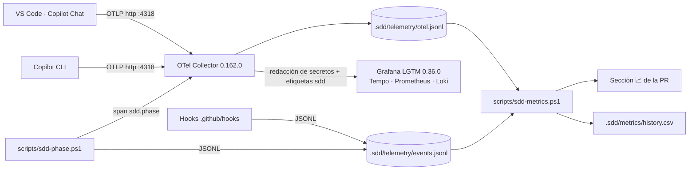

# Observabilidad del proceso de agentes

Stack local para ver **tiempos, tokens, coste, agentes, subagentes y fases** del ciclo SDD (plan §9, decisiones D-06/D-07).



## Arranque

```powershell
./scripts/bootstrap/enable-agent-telemetry.ps1     # una vez por máquina: ajustes de usuario de VS Code + carpeta de confianza del CLI
docker compose -f observability/compose.yaml up -d
```

Después, recarga VS Code (*Developer: Reload Window*).

| Servicio | URL | Notas |
|---|---|---|
| Grafana | <http://localhost:3000> | Dashboard **SDD › SDD · Proceso de agentes**. Acceso anónimo de administrador: solo escucha en `127.0.0.1` |
| OTLP HTTP / gRPC | `http://localhost:4318` / `localhost:4317` | Endpoint para VS Code y Copilot CLI |

Para parar: `docker compose -f observability/compose.yaml down`. Para **borrar todos los datos** (p. ej. antes de la línea base de C0): añade `-v` y borra `.sdd/telemetry/`.

## Fuentes de telemetría

| Fuente | Configuración | Qué aporta |
|---|---|---|
| Copilot Chat (VS Code) | **Ajustes de usuario** (`github.copilot.chat.otel.*`, ámbito *application*: VS Code los ignora en `.vscode/settings.json`). Se aplican con `./scripts/bootstrap/enable-agent-telemetry.ps1` | Trazas de agentes y subagentes, tokens, herramientas. Correlación por rama `sdd/<change>` |
| Copilot CLI | Variables de entorno (abajo) | Lo mismo + `sdd.change_id`/`sdd.phase` como atributos de recurso |
| `scripts/sdd-phase.ps1` | Lo invoca el `sdd-conductor` | Inicio/fin de cada fase. Al terminar, publica un span `sdd.phase <fase>`; todas las fases de un change comparten traza |
| Hooks (`.github/hooks/sdd-telemetry.json`) | Automático | `sessionStart/End`, `subagentStart/Stop`, `postToolUseFailure`, `errorOccurred` → `events.jsonl` (incluyen `traceparent`) |

Variables para ejecutar agentes con Copilot CLI:

```powershell
$env:OTEL_EXPORTER_OTLP_ENDPOINT = "http://localhost:4318"
$env:OTEL_INSTRUMENTATION_GENAI_CAPTURE_MESSAGE_CONTENT = "true"
$env:OTEL_RESOURCE_ATTRIBUTES = "sdd.change_id=<change>,sdd.phase=<fase>"
$env:SDD_CHANGE_ID = "<change>"; $env:SDD_PHASE = "<fase>"   # para los hooks
```

## Métricas por change

```powershell
./scripts/sdd-metrics.ps1 -Change <change>                                   # tabla Markdown para la PR
./scripts/sdd-metrics.ps1 -Change <change> -ReviewIterations 2 -Blockers 1 -AppendHistory   # + fila en history.csv
./scripts/sdd-metrics.ps1 -Change <change> -Format json
```

Los tokens se suman desde los spans `chat` (los `invoke_agent` llevan totales de sesión y duplicarían). Cada llamada se atribuye a su `invoke_agent` más cercano, así que cada subagente (p. ej. los 4 revisores) tiene su fila.

## Lecciones de la puesta en marcha (F3)

- **Los hooks del repo solo se ejecutan en carpetas de confianza.** En Copilot CLI la lista está en `~/.copilot/config.json` → `trustedFolders` (no en `settings.json`). `enable-agent-telemetry.ps1` la configura (lección L-001).
- **Los ajustes OTel de Copilot Chat son de usuario**, no de workspace (lección L-002).
- **Procesos de vida corta:** cada ejecución del CLI exporta sus contadores una sola vez al terminar, así que `rate()`/`increase()` no devuelven nada. El dashboard usa `max_over_time(...[$__range])` por serie.
- **Grafana LGTM solo lee el aprovisionamiento de dashboards al arrancar:** tras editar `dashboards/*.json`, ejecuta `docker compose -f observability/compose.yaml restart lgtm`.
- **Redacción de secretos:** el collector enmascara tokens de GitHub (`gh*_`, `github_pat_`), cabeceras `Bearer/Basic` y claves privadas antes de exportar. Verificado con un token falso en el prompt: no aparece en ningún destino.
- **Etiquetas por change:** el collector copia `sdd.change_id` y `sdd.phase` del recurso a cada punto de métrica para poder agrupar en Prometheus.
